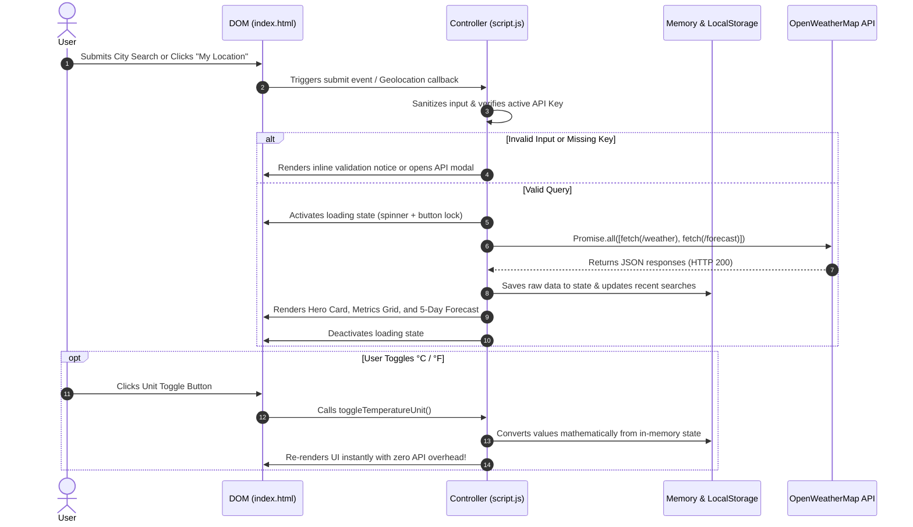

# SkyPulse Weather Dashboard — Technical Implementation Documentation

This document provides a comprehensive, component-by-component, and architectural technical reference for every implementation in the **SkyPulse Weather Dashboard**.

---

## 1. System Architecture & High-Level Design

SkyPulse follows a clean **Model-View-Controller (MVC) inspired** vanilla architecture:
- **Model / State (`script.js`)**: Holds current active unit (`metric` / `imperial`), raw API responses in memory for zero-refetch conversions, request locks (`isLoading`), and `localStorage` persistence.
- **View / Presentation (`index.html` & `style.css`)**: Semantic HTML5 elements and modern CSS3 Glassmorphism UI components structured with CSS Grid and Flexbox.
- **Controller / Logic (`script.js`)**: Coordinates user events, form submissions, Geolocation API queries, OpenWeatherMap REST calls, data transformation, and DOM rendering.

### End-to-End Execution Flow


---

## 2. File Implementation Breakdown

### 2.1. `index.html`

`index.html` provides the accessible, semantic backbone of the dashboard.

#### Key Structural Sections

1. **Document Head & Assets (`Lines 1–14`)**:
   - `<meta name="viewport" content="width=device-width, initial-scale=1.0">`: Ensures responsive viewport rendering without horizontal overflow.
   - Google Font `<link>`: Loads **Inter** font family (`wght@300;400;500;600;700;800`) for typography.
   - SVG Data URI favicon: Embeds a lightweight weather emoji favicon (`🌤️`) avoiding missing favicon HTTP 404 requests.

2. **Application Header (`Lines 18–38`)**:
   - `<div class="brand">`: Houses the logo emoji and title hierarchy (`<h1>SkyPulse</h1>`, `<p class="brand-subtitle">`).
   - `<button id="unit-toggle">`: Accessible toggle button displaying active unit state (`#unit-c` vs `#unit-f`).
   - `<button id="api-modal-btn">`: Settings trigger with SVG gear icon for opening the custom API key dialog.

3. **Search & Action Section (`Lines 43–86`)**:
   - `<form id="search-form" role="search" novalidate>`: Accessible form wrapper capturing both button clicks and native `Enter` key submissions.
   - `<input id="city-input">`: Search field with `spellcheck="false"`, `autocomplete="off"`, and hidden `<label class="sr-only">`.
   - `<button id="clear-search-btn">`: One-click clear button toggled when input contains text.
   - `<button id="search-btn">`: Primary submit button.
   - `<button id="location-btn">`: Browser geolocation trigger with SVG crosshair icon.
   - `<div id="validation-msg">`: Inline alert box with `role="alert"` and `aria-live="polite"` preventing intrusive `alert()` modals.
   - `<div id="recent-searches-container">`: Chip container displaying persistent recent queries.

4. **Status States (`Lines 89–113`)**:
   - `#welcome-state`: Initial friendly greeting card displayed on first visit before any query is made.
   - `#loading-state`: Accessible loading container (`aria-busy="true"`) housing the CSS dual-ring spinner.
   - `#error-state`: Accessible error card (`aria-live="assertive"`) showing customizable error titles, descriptions, and a "Try Again" button.

5. **Active Weather Dashboard (`Lines 116–226`)**:
   - **Hero Card (`#hero-card`)**:
     - `#city-name` & `#country-badge`: Formatted location and ISO country code.
     - `#local-time`: Local time calculated using the city's specific UTC timezone offset.
     - `#current-temp` & `#temp-unit`: Large temperature headline.
     - `#weather-description`: Capitalized description (e.g. "Overcast Clouds").
     - `#temp-max` & `#temp-min`: Diurnal range badge.
     - `#weather-icon`: 128px high-resolution OpenWeather image with floating animation.
   - **Metrics Grid (`.metrics-grid`)**:
     - 6 responsive cards displaying: Feels Like, Humidity, Wind Velocity & 16-point Compass Direction, Atmospheric Pressure, Visibility, and Local Sunrise/Sunset times.
   - **5-Day Forecast Strip (`.forecast-section`)**:
     - `#forecast-cards`: CSS Grid container populated dynamically with daily summary cards.

6. **API Key Settings Modal (`Lines 236–260`)**:
   - Accessible dialog (`role="dialog"`, `aria-modal="true"`) allowing users to store or reset an OpenWeather key in browser `localStorage`.

---

### 2.2. `style.css`

`style.css` implements modern responsive design principles using CSS custom properties, glassmorphism, and responsive CSS Grid.

#### Key Architectural Implementations

1. **Design Tokens (`:root`, Lines 11–43)**:
   - Centralized CSS variables for palette (`--bg-gradient`, `--card-bg`, `--accent-primary`), typography (`--font-sans`), shadows (`--card-shadow`), and transitions (`--transition-fast`, `--transition-smooth`).

2. **Base Layout & Glassmorphism (`Lines 49–78`)**:
   - `background-attachment: fixed`: Fixes the gradient background during scrolling.
   - `backdrop-filter: blur(14px)`: Delivers frosted glass aesthetic across cards while maintaining WCAG AA contrast ratios against light text (`#f8fafc`).

3. **Accessibility Utilities (`Lines 80–91`)**:
   - `.sr-only`: Visually hides elements while preserving screen-reader discoverability.
   - `:focus-visible`: Displays prominent 2px sky-cyan focus rings for keyboard navigators.

4. **Component Layouts**:
   - `.search-form`: Flexible horizontal layout on desktop, stacked on mobile.
   - `.metrics-grid`: 3-column grid on desktop (`repeat(3, 1fr)`), 2-column on tablets, and 1-column on mobile.
   - `.forecast-cards`: 5-column grid on desktop (`repeat(5, 1fr)`), adapting to 3-column, 2-column, and 1-column across breakpoints.

5. **Custom Keyframe Animations (`Lines 434–457`)**:
   - `@keyframes spin`: Smooth 360-degree rotation for the loading spinner.
   - `@keyframes fadeInUp`: Elegant entry transition for newly loaded weather cards.
   - `@keyframes gentleFloat`: Subtle vertical levitation effect for the weather condition icon.

---

### 2.3. `script.js`

`script.js` contains the complete application logic written in clean, modern vanilla JavaScript.

#### Architectural Breakdown

```
script.js
├── 1. CONFIG: Base endpoints, default placeholder key, storage keys
├── 2. State: Active unit, request locking, in-memory weather cache
├── 3. DOM Cache: Centralized object referencing all 44 DOM elements
├── 4. API Key Resolution: Fallback chain (localStorage -> CONFIG.DEFAULT_API_KEY)
├── 5. Utilities: Temp conversion, wind formatting, timezone solar math
├── 6. UI State Management: showLoading, hideLoading, showError, validation
├── 7. Data Fetching: Parallel Promise.all() fetch for weather and forecast
├── 8. Rendering Engine: Hero card, metrics grid, and 5-day forecast grouping
├── 9. Recent Searches: LocalStorage read, deduplication, and chip rendering
├── 10. Unit Toggle System: Zero-refetch mathematical conversion system
├── 11. Geolocation Handler: HTML5 navigator.geolocation coordinates lookup
├── 12. Modal System: API Key settings configuration
├── 13. Event Listeners: Input handling, keyboard submit, modal triggers
└── 14. Initialization: Restoring preferences, auto-loading last city
```

#### Detailed Logic Explanations

1. **Parallel API Execution (`fetchWeather()`)**:
   ```javascript
   const [weatherRes, forecastRes] = await Promise.all([
       fetch(weatherUrl),
       fetch(forecastUrl)
   ]);
   ```
   *Rationale*: Eliminates sequential request latency (waterfalling) by dispatching both network calls concurrently, reducing total fetch time by up to 50%.

2. **Zero-Refetch Unit Conversion (`setTemperatureUnit()`)**:
   *Rationale*: When switching between Celsius and Fahrenheit, re-querying the API consumes API quota and adds network latency. SkyPulse preserves the raw metric data in `state.rawWeatherData` and re-runs the rendering engine mathematically:
   $$\text{Temp}_{°F} = \left(\text{Temp}_{°C} \times \frac{9}{5}\right) + 32$$
   $$\text{Speed}_{\text{mph}} = \text{Speed}_{\text{m/s}} \times 2.23694$$

3. **Accurate Solar & Local Time Normalization (`formatSunTime()`, `formatLocalTime()`)**:
   *Problem*: Standard `new Date(timestamp * 1000)` formats timestamps according to the *user's* local computer clock, which is inaccurate when a user in New York queries weather for Tokyo.
   *Solution*: SkyPulse calculates local milliseconds by applying the city's UTC timezone offset in seconds:
   ```javascript
   const localMillis = (unixTimestamp + timezoneOffsetSeconds) * 1000;
   const date = new Date(localMillis);
   // Format using timeZone: "UTC" to prevent browser offset interference
   ```

4. **5-Day Forecast Aggregation Algorithm (`renderForecast()`)**:
   *Problem*: The OpenWeather `/forecast` endpoint provides 40 data points (every 3 hours for 5 days).
   *Solution*:
   - Iterates through the 40 items and groups them into a `Map` keyed by local calendar date (`YYYY-MM-DD`).
   - For each calendar date, calculates the true diurnal minimum and maximum temperatures across all 3-hour readings.
   - Selects the reading closest to midday (12:00 UTC local) to accurately represent daylight weather condition and icon.

5. **Persistent Search History (`saveRecentSearch()`)**:
   - Manages a FIFO (First-In, First-Out) cache of up to 5 cities in `localStorage`.
   - Performs case-insensitive deduplication before prepending the new search.

---

## 3. Error Handling Matrix

| Scenario | HTTP / Error Code | Application Response |
| :--- | :--- | :--- |
| **Empty Input** | Client validation | Displays inline notice in `#validation-msg`; focuses input field. |
| **City Not Found** | HTTP 404 | Displays `#error-state`: "City Not Found. We could not find [city]. Please verify spelling." |
| **Invalid API Key** | HTTP 401 | Displays `#error-state`: "Authentication Failed. Your OpenWeather API key is invalid or pending activation." Opens settings modal. |
| **Rate Limit Exceeded** | HTTP 429 | Displays `#error-state`: "Rate Limit Exceeded. You have exceeded free tier limits. Please wait a minute." |
| **Network Disconnected** | `TypeError: Failed to fetch` | Displays `#error-state`: "Connection Problem. Unable to reach the meteorological service." |
| **Geolocation Denied** | `error.PERMISSION_DENIED` | Informs user that permission was denied and advises searching manually. |
| **Simultaneous Clicks** | Client-side lock (`state.isLoading`) | Disables search and location buttons until previous network request resolves. |

---

## 4. Maintenance & Security Checklist

- [x] **Safe Git Deployment**: `CONFIG.DEFAULT_API_KEY` set to `"YOUR_API_KEY_HERE"`.
- [x] **No Leaked Secrets**: `.gitignore` contains rules for `.env`, secrets, and OS temp files.
- [x] **Redundant Files Removed**: Duplicate `Weather App.html` removed from the repository.
- [x] **Accessibility**: Verified WCAG AA color contrast and keyboard tab traversal.
